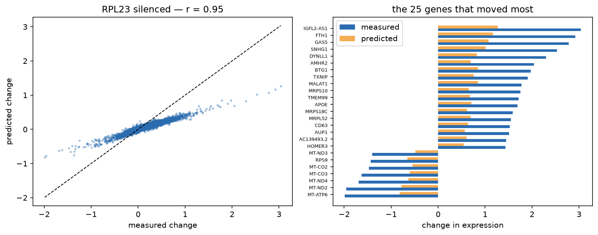
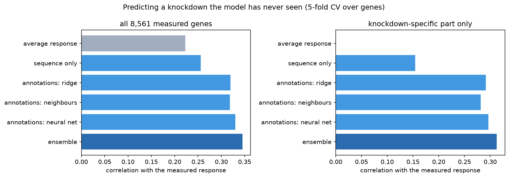
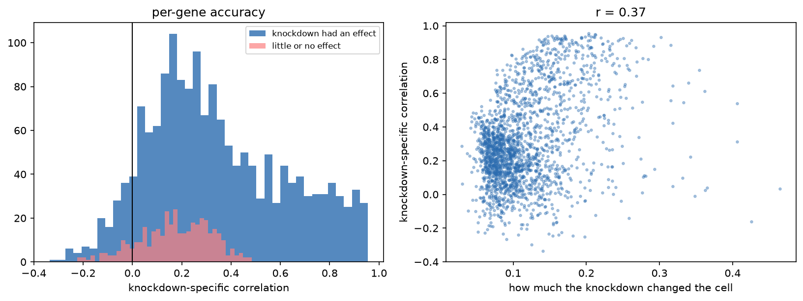

# Predicting the transcriptional response to an unseen gene knockdown

[](https://colab.research.google.com/github/eersin1/virtual-cell/blob/main/virtual_cell.ipynb)

Silencing one gene in a human cell shifts thousands of others. Given a gene the model has never
seen, can its whole signature be predicted from a description of what that gene is?

Most drugs work by blocking one protein, which is roughly a knockdown. Predicting the cell's
response in software is the first step toward judging a target before anyone runs the experiment.



`RPL23` is a ribosomal protein, held out of training entirely. The model gets the direction right
for all 25 of the genes that moved most: mitochondrial genes down, growth-arrest and stress genes
up. That's the textbook signature of blocking protein synthesis.

## Result

2,057 silenced genes by 8,561 measured genes, 5-fold cross-validation over genes. Every scored gene
was absent from training, and each gene's own column is excluded from scoring.

| model | all genes | top 50 | knockdown-specific |
|---|---|---|---|
| average response (baseline) | 0.223 | 0.425 | 0.000 |
| protein sequence only (ESM-2) | 0.256 | 0.465 | 0.154 |
| annotations: ridge | 0.319 | 0.542 | 0.291 |
| annotations: nearest neighbours | 0.318 | 0.510 | 0.281 |
| annotations: neural network | 0.330 | 0.516 | 0.297 |
| **ensemble** | **0.345** | **0.555** | **0.313** |
| ensemble + ESM-2 | 0.345 | 0.553 | 0.314 |

**The last column is the one that matters.** Silencing almost any essential gene makes the cell
unwell, and unwell cells look alike, so "just predict the average response" is already a strong
baseline at 0.223. The knockdown-specific metric strips that shared response out of both prediction
and truth, leaving only what's distinctive about this gene. The baseline scores exactly 0 there by
construction.



Two results cut against expectation, and they're the more interesting half.

**The neural network barely beats ridge regression** (0.330 vs 0.319) and is *worse* on the genes
that moved most (0.516 vs 0.542). That matches
[Ahlmann-Eltze et al., *Nature Methods* 2025](https://doi.org/10.1038/s41592-025-02772-6), who
found deep models struggle to beat simple baselines at exactly this task.

**ESM-2 adds nothing on top of curated annotations.** Sequence alone beats the baseline (0.256 vs
0.223), so a protein language model that has never seen an experiment does carry real information
about what removing that protein does. But adding it to the ensemble changes nothing (0.345 to
0.345). That information is already in what biologists wrote down.



The failures aren't random. Accuracy tracks effect size: knockdowns that barely perturbed the cell
are mostly unpredictable, because there was little but noise to predict.

## Method

- **Data:** [Replogle et al., *Cell* 2022](https://doi.org/10.1016/j.cell.2022.05.013) genome-wide
  Perturb-seq, CRISPRi in K562, pseudobulk.
- **Gene descriptions** from three independent sources: Gene Ontology (TF-IDF then SVD, 256 dims),
  STRING v12 (symmetrically normalised adjacency then SVD, 256 dims), and ESM-2 650M mean residue
  embeddings (1,280 dims).
- **Models predict the residual**, meaning the response minus the average training response, so
  capacity goes on what's distinctive rather than on the shared stress response.
- **Ensemble** of ridge, nearest neighbours and an MLP, weighted 0.4 / 0.2 / 0.4.

All scaling, PCA and feature standardisation are fit on training genes only.

## Limitations

- **One cell type.** K562 is a leukaemia line. Nothing here shows the model transfers.
- Pseudobulk averaging throws away cell-to-cell variation.
- CRISPRi knocks a gene *down*, not out, and residual expression varies by gene.
- **GO and STRING are built from published experiments, so well-studied genes carry richer
  descriptions.** The model is partly rewarded for a gene being famous, and performance on a
  genuinely uncharacterised gene, which is the case you'd actually care about, would be lower.
  Quantifying this is the best next experiment.
- Predictions are systematically too small in magnitude (ridge shrinkage, visible as a slope below
  1 in the scatter above).
- Ensemble weights were picked by hand.

## Prior work

Not methodologically novel. [GEARS](https://doi.org/10.1038/s41587-023-01905-6) and
[scGPT](https://doi.org/10.1038/s41592-024-02201-0) are the established models for this task and
this project doesn't compare against them directly. What's mine is the careful baseline comparison
and the negative result on protein-sequence features.

## Running it

Open in Colab with the badge above, or locally:

```bash
pip install numpy pandas scipy scikit-learn matplotlib h5py anndata torch fair-esm jupyter
jupyter notebook virtual_cell.ipynb
```

The notebook downloads its own data (~190 MB) and checks each file parses to its end before using
it. A half-downloaded file is still a large file, and otherwise fails confusingly much later.

The slow step is computing ESM-2 embeddings for ~1,900 proteins: a few minutes on a GPU,
considerably longer on CPU. It's cached, so it only happens once.
